# AIBOX SERVER 圖解 SOP

> 一張圖一個步驟。每一步的完整指令與說明在文字版 [AIBOX-SERVER-建置SOP.md](AIBOX-SERVER-建置SOP.md)。
> 圖中畫面都是實際安裝後的截圖，IP 以 `192.168.0.179` 為例。PDF 版：[pdf/AIBOX-SERVER-圖解SOP.pdf](pdf/AIBOX-SERVER-圖解SOP.pdf)

---

## ① 準備虛擬機

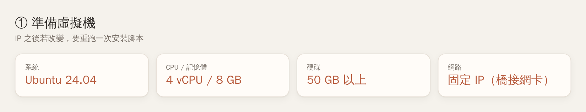

## ② 安裝 Docker

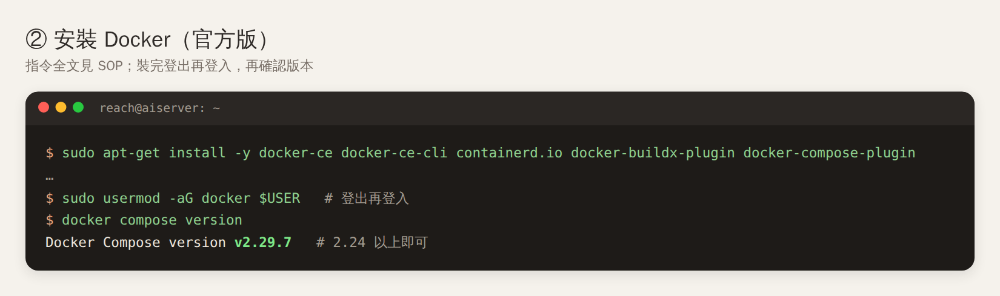

完整指令見文字版第 ② 步。裝完一定要**登出再登入**，`docker` 指令才不需要 sudo。

## ③ 取得程式

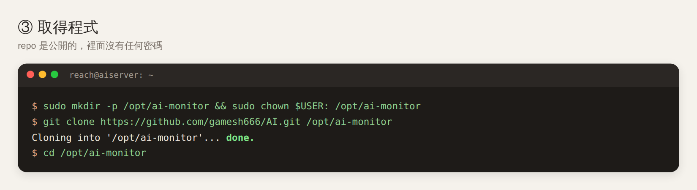

## ④ 一鍵安裝

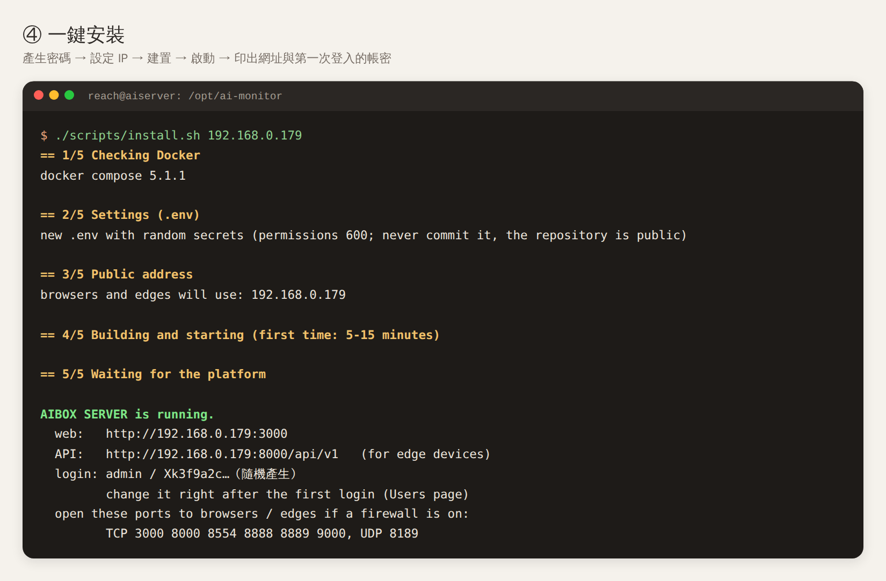

- 最後印出的 `login: admin / ...` 就是第一次登入的密碼，**只在第一次安裝時顯示**。
- 之後要再查：`grep ^INITIAL_ADMIN_PASSWORD .env`（改過密碼後就不再適用）。

## ⑤ 第一次登入、改密碼

瀏覽器開 `http://192.168.0.179:3000`，輸入上一步的帳密：

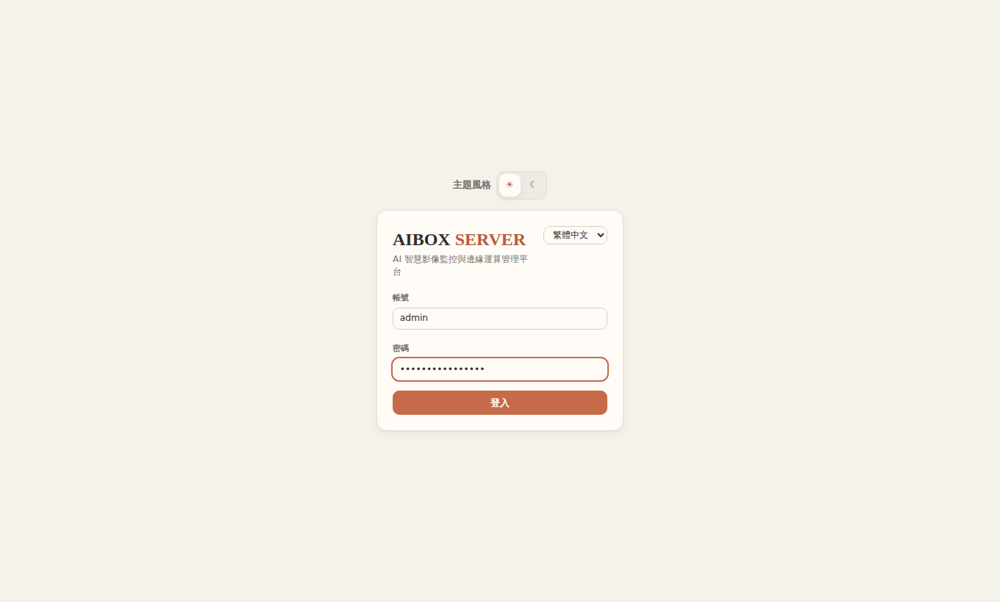

登入後是空的總覽頁，還沒有任何裝置：

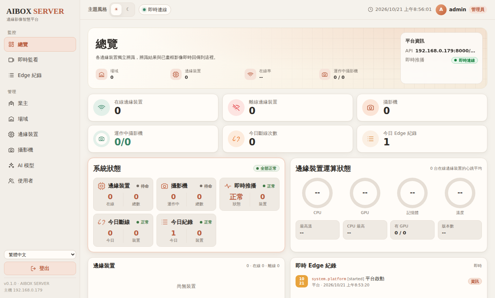

**立刻改密碼**：「使用者」→ admin 那一列按「編輯」→ 填「新密碼」→ 儲存。

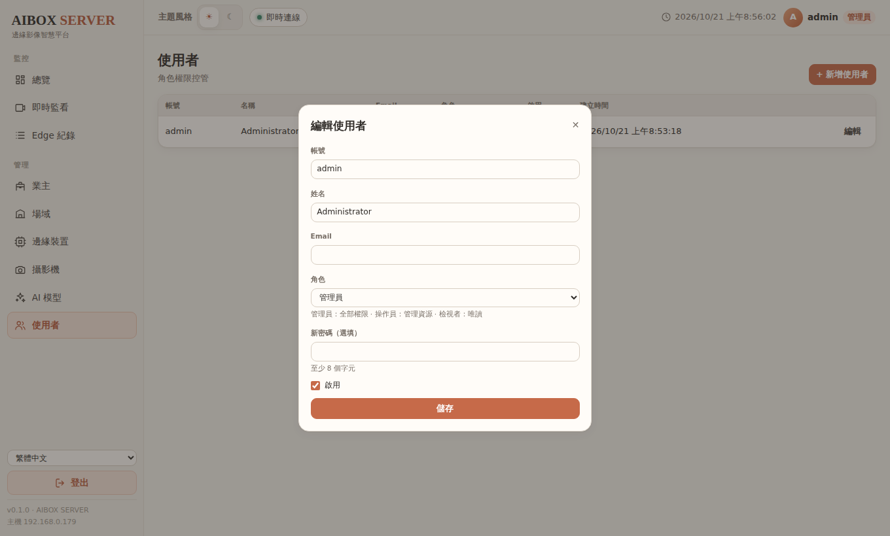

## ⑥ 防火牆

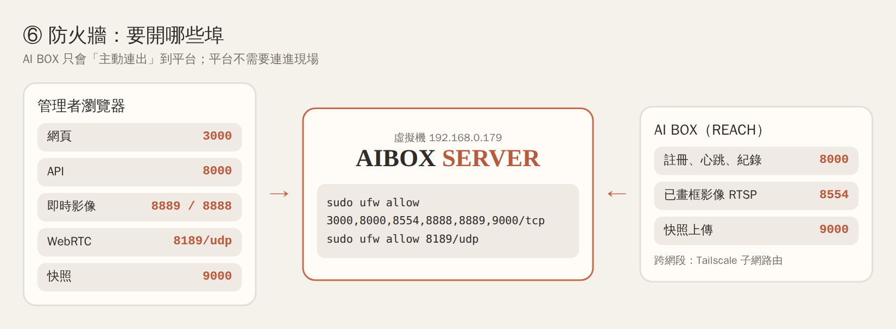

## ⑦ 接上 AI BOX

**1. 新增業主**：「業主」→「+ 新增業主」，填公司資料。

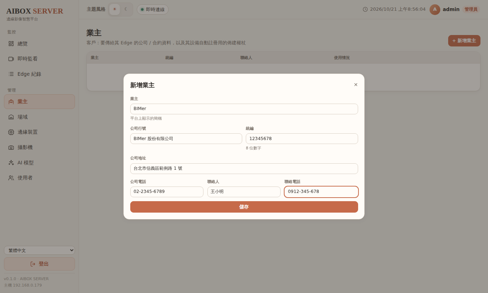

**2. 新增場域**：「場域」→「+ 新增場域」，選剛才的業主。

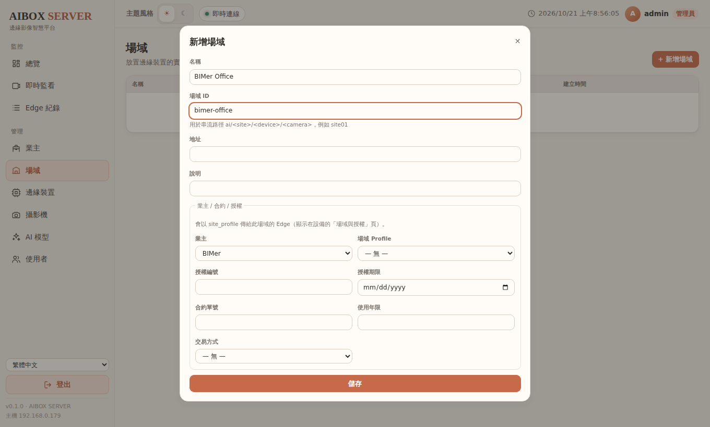

**3. 產生佈建權杖**：「業主」→ 該業主「佈建權杖」→ 選場域 →「產生權杖」。
權杖**只顯示這一次**，按「複製全部」，把兩行設定放進 AI BOX 的設定檔。

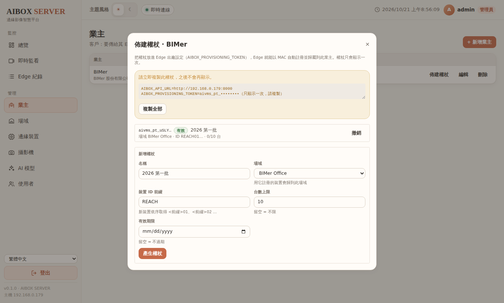

撤銷的權杖 5 分鐘後自動刪除；按「重新整理」會立即刪除並依產生日期重新排列。

**4. AI BOX 按「自動綁定」**：平台自動編號（REACH01、REACH02…）、把這台的金鑰直接交給 AI BOX 保存、帶回場域資料。
裝置**只能**這樣上線，沒有手動新增，也沒有人需要經手金鑰。幾秒後「邊緣裝置」頁就會出現這台，狀態「在線」：

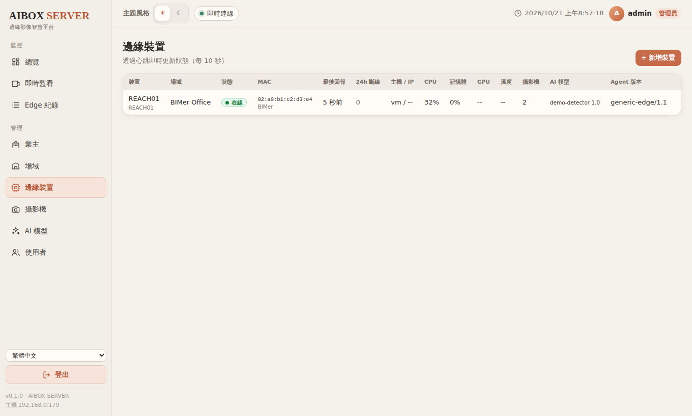

**5. 產生報表**：裝置列按「產生報表」，選條件 →「產生 PDF」。AI BOX 用自己的資料庫產生「出勤與事件報表」傳回來，
約 10–30 秒後按「下載 PDF」：

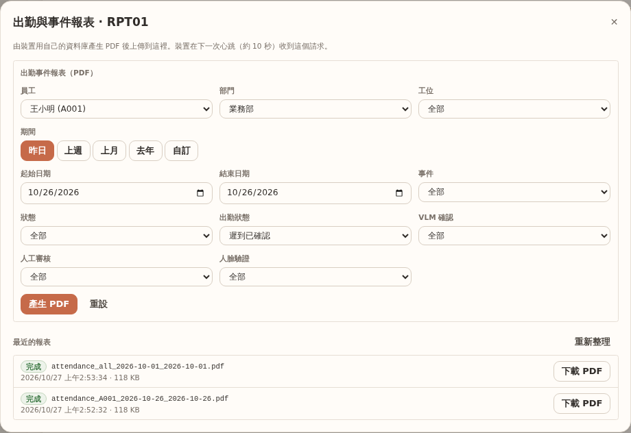

## ⑧ 驗收

**總覽**：在線裝置、攝影機、今日紀錄都有數字，「即時 Edge 紀錄」持續出現新紀錄。

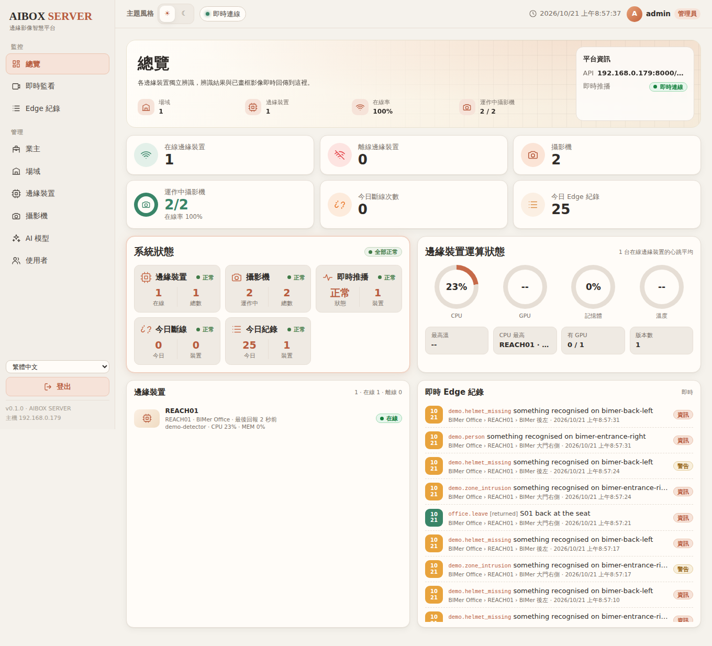

**Edge 紀錄**：每筆辨識結果，右側是快照縮圖。

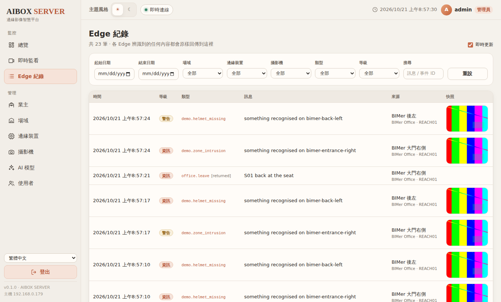

**點快照**：以 480p 放大，框線是 AI BOX 回報的辨識位置。

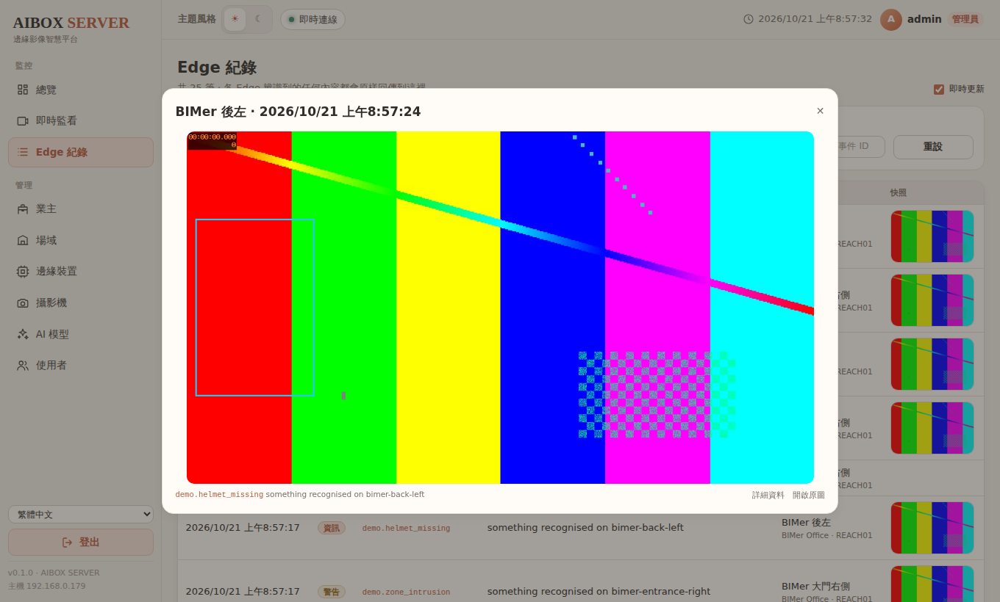

**即時監看**：每支攝影機都有已畫框的即時影像。請用 Chrome 或 Edge 瀏覽器開啟。

| 檢查 | 預期 |
|------|------|
| 邊緣裝置頁 | 狀態「在線」，「最後回報」每 10 秒更新 |
| 即時監看頁 | 每支攝影機都有畫面 |
| Edge 紀錄頁 | 持續有新紀錄，快照可放大 |
| 邊緣裝置頁「產生報表」 | 約 10–30 秒後可下載 PDF |
| 拔掉 AI BOX 網路 1 分鐘再接回 | 約 30 秒內顯示離線；恢復後記錄中斷多久 |
| VM 上執行 `./scripts/doctor.sh` | 沒有 FAIL |

## ⑨ 搬到新的虛擬機（需要保留資料時）

指令見文字版第 ⑨ 步。
