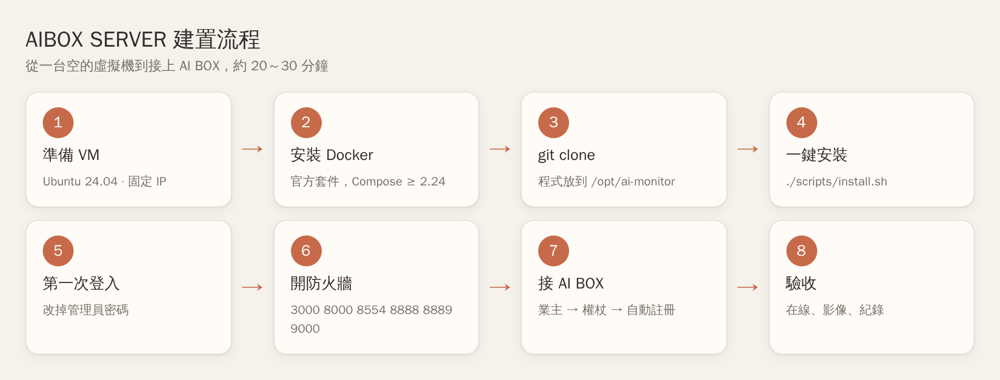
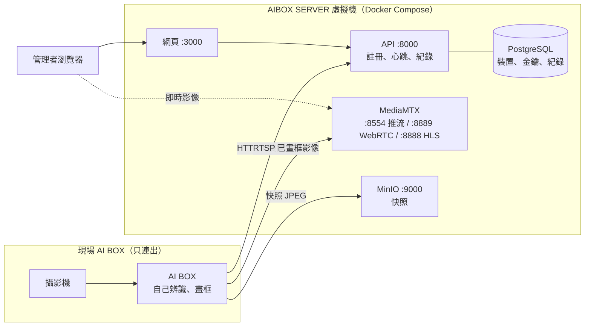
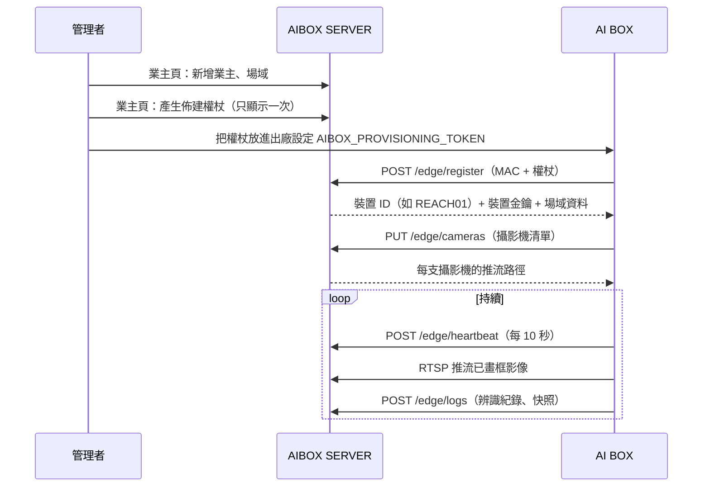
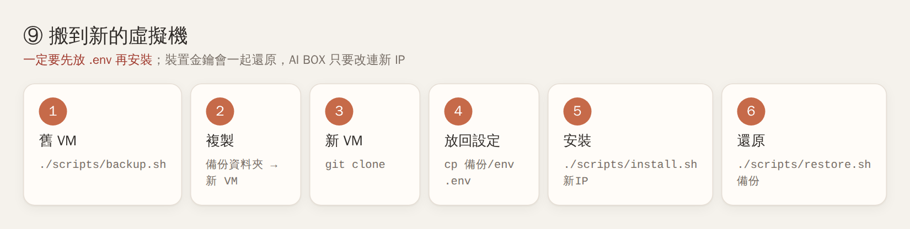

# AIBOX SERVER 建置 SOP（新虛擬機從零到上線）

> 適用：在任何一台新的 Linux 虛擬機上，從 `git clone` 開始架起 AIBOX SERVER 平台，接上 REACH 等 AI BOX。
> 圖解版：[AIBOX-SERVER-圖解SOP.md](AIBOX-SERVER-圖解SOP.md)　PDF：[pdf/](pdf/)
> 全程約 20～30 分鐘，其中第一次建置映像檔約佔 5～15 分鐘。
> 需要的指令都在本文件，照順序貼上即可。

## 總覽



裝好之後的樣子：



- AI BOX 一律**主動連出**到平台，平台從不連進現場。
- 回報全部走 HTTP，每台用自己的裝置金鑰。

---

## ① 準備虛擬機

| 項目 | 建議 |
|------|------|
| 系統 | Ubuntu 24.04 LTS（22.04 也可） |
| CPU / 記憶體 | 4 vCPU / 8 GB |
| 硬碟 | 50 GB 以上（快照與紀錄會持續累積） |
| 網路 | **固定 IP**（DHCP 保留或手動設定）。VirtualBox / VMware 用「橋接」網卡 |

IP 之後若改變，要重跑一次安裝腳本（見「⑩ 日常維護」）。

## ② 安裝 Docker（官方版）

Ubuntu 內建的 `docker.io`、snap 版太舊，請用 Docker 官方套件（需要 Compose 2.24 以上）：

```bash
sudo apt-get update && sudo apt-get install -y ca-certificates curl git openssl
sudo install -m 0755 -d /etc/apt/keyrings
sudo curl -fsSL https://download.docker.com/linux/ubuntu/gpg -o /etc/apt/keyrings/docker.asc
echo "deb [arch=$(dpkg --print-architecture) signed-by=/etc/apt/keyrings/docker.asc] https://download.docker.com/linux/ubuntu $(. /etc/os-release && echo $VERSION_CODENAME) stable" \
  | sudo tee /etc/apt/sources.list.d/docker.list
sudo apt-get update && sudo apt-get install -y docker-ce docker-ce-cli containerd.io docker-buildx-plugin docker-compose-plugin
sudo usermod -aG docker $USER
```

**登出再登入**（讓 docker 群組生效），然後確認：

```bash
docker compose version     # 顯示 2.24 以上
```

## ③ 取得程式

```bash
sudo mkdir -p /opt/ai-monitor && sudo chown $USER: /opt/ai-monitor
git clone https://github.com/gamesh666/AI.git /opt/ai-monitor
cd /opt/ai-monitor
```

- 這個 repo 是**公開**的，裡面沒有任何密碼。密碼都在下一步產生的 `.env`，只存在這台 VM 上。

## ④ 一鍵安裝

```bash
./scripts/install.sh               # 自動抓這台 VM 的 IP
# 或指定 IP（VM 有多張網卡、或要用 Tailscale 位址時）：
./scripts/install.sh 192.168.0.179
```

腳本會依序做：

| 步驟 | 內容 |
|------|------|
| 1/5 | 檢查 Docker、Compose 版本、openssl |
| 2/5 | 沒有 `.env` 就產生一份（全部隨機密碼、權限 600）；已有就沿用 |
| 3/5 | 把網頁、API、推流、快照的對外位址設成這台 VM 的 IP |
| 4/5 | 建置並啟動所有服務（**不含**示範裝置） |
| 5/5 | 等到平台可以使用，印出網址與第一次登入的帳密 |

成功時最後會顯示：

```text
AIBOX SERVER is running.
  web:   http://192.168.0.179:3000
  API:   http://192.168.0.179:8000/api/v1   (for edge devices)
  login: admin / <隨機密碼>
```

## ⑤ 第一次登入

1. 瀏覽器開 `http://<VM IP>:3000`，用上一步印出的 `admin` 帳密登入。
2. **立刻改密碼**：「使用者」頁 → admin 那一列按「編輯」→ 填入新密碼 → 儲存。
3. 依需要建立其他帳號（admin 管理員、operator 操作員、viewer 檢視者）。

## ⑥ 防火牆

VM 有啟用 ufw 時：

```bash
sudo ufw allow 3000,8000,8554,8888,8889,9000/tcp
sudo ufw allow 8189/udp      # WebRTC 即時影像；沒開會自動改用 HLS（延遲較高）
sudo ufw allow 8890/udp      # 只有 AI BOX 用 SRT 推流（跨網際網路）時才需要
```

| 埠 | 誰會連 | 用途 |
|----|--------|------|
| 3000 | 瀏覽器 | 網頁 |
| 8000 | 瀏覽器、AI BOX | API（註冊、心跳、紀錄） |
| 8554 | AI BOX | 推送已畫框的影像（RTSP） |
| 8889 / 8888 | 瀏覽器 | 即時影像（WebRTC / HLS） |
| 8189/udp | 瀏覽器 | WebRTC 影像資料 |
| 9000 | 瀏覽器、AI BOX | 快照上傳與顯示 |

**跨網段的 AI BOX**（例如在 192.168.89.x）：在 VM 上裝 Tailscale 並宣告子網路由，AI BOX 端也加入同一個 Tailscale 網路，設定照樣填 VM 的區網 IP 即可（做法見 `docs/partners/reach/03-AIBOX-SERVER與REACH01-02串接說明.md` 第 3 節）。

## ⑦ 接邊緣裝置



AI BOX **只用佈建權杖**上線，平台沒有手動新增裝置，也不需要任何人經手金鑰：

1. 「業主」頁：新增業主。「場域」頁：新增場域並選這個業主。
2. 「業主」頁：該業主 →「佈建權杖」→ 產生。權杖**只顯示一次**，請複製。
3. 把畫面上的兩行設定放進 AI BOX 的設定檔：`AIBOX_API_URL=http://<VM IP>:8000`、`AIBOX_PROVISIONING_TOKEN=...`。
4. 在 AI BOX 按「自動綁定」。平台自動編號（REACH01、REACH02…），把這台自己的金鑰交給 BOX 保存，並帶回業主 / 場域資料。

權杖用完可以「撤銷」：撤銷 5 分鐘後平台自動刪除（按「重新整理」立即刪除並依產生日期重新排列）。
已綁定的 AI BOX 不受影響；之後要重新綁定（例如 BOX 重灌）再產生一個新權杖即可。

**產生報表**：「邊緣裝置」頁該台 →「產生報表」，選員工 / 部門 / 期間等條件 →「產生 PDF」。
AI BOX 在下一次心跳（約 10 秒）收到請求，用自己的資料庫產生「出勤與事件報表」PDF 傳回來，完成後按「下載 PDF」。

AI BOX 端要改什麼，見 `docs/partners/reach/05-REACH-更新規格v2.md` 與 `06-REACH-更新規格v3-報表與權杖.md`。

## ⑧ 驗收

| 檢查 | 位置 | 預期 |
|------|------|------|
| 平台正常 | VM 上執行 `./scripts/doctor.sh` | 沒有 FAIL |
| 裝置在線 | 邊緣裝置頁 | 狀態「在線」 |
| 報表 | 邊緣裝置頁 →「產生報表」 | 約 10–30 秒後出現「下載 PDF」 |
| 即時影像 | 即時監看頁 | 每支攝影機都有畫面 |
| 辨識紀錄 | Edge 紀錄頁 | 有新紀錄，點快照可放大到 480p |
| 斷線偵測 | 拔掉 AI BOX 網路 1 分鐘再接回 | 約 30 秒內顯示離線，恢復後記錄中斷多久 |

## ⑨ 搬家：從舊 VM 移到新 VM

`git clone` 只帶程式，**資料不會跟著過去**（裝置、金鑰、業主、紀錄、快照都在舊 VM 的 Docker volume 裡）。要保留資料：



```bash
# 舊 VM
cd /opt/ai-monitor && ./scripts/backup.sh          # -> backups/aibox-日期時間/
scp -r backups/aibox-20261021-0930 user@<新VM IP>:~/

# 新 VM（照 ①～③ 做完，先不要跑 install.sh）
cd /opt/ai-monitor
cp ~/aibox-20261021-0930/env .env && chmod 600 .env  # 沿用舊的密碼與金鑰設定
./scripts/install.sh                                  # 會改成新 VM 的 IP
./scripts/restore.sh ~/aibox-20261021-0930            # 輸入 yes 確認
```

- **一定要先放 `.env` 再跑 install.sh**。順序反了，資料庫會用新密碼初始化，就要整個重來（`docker compose down -v`）。
- 裝置金鑰會一起還原，AI BOX 不用重新綁定。IP 有變時，只要把每台 BOX 設定裡的平台位址改成新 IP。
- 備份資料夾含 `.env` 等機密：不要放進 Git，不要傳到群組。

## ⑩ 日常維護

| 要做的事 | 指令（都在 `/opt/ai-monitor` 執行） |
|----------|--------------------------------------|
| 更新程式 | `git pull && ./scripts/install.sh` |
| 只重新啟動 | `./scripts/install.sh --no-build` |
| VM 的 IP 改了 | `./scripts/install.sh <新IP>`，然後通知每台 AI BOX 改位址 |
| 備份 | `./scripts/backup.sh`（建議每天排程，並把備份複製到別台機器） |
| 健康檢查 | `./scripts/doctor.sh` |
| 看後端錯誤 | `docker compose logs backend --tail 100` |
| 忘記管理員密碼 | `docker compose exec backend python -m app.cli.set_password admin` |
| 停止平台 | `docker compose down`（**不要**加 `-v`，`-v` 會刪掉所有資料） |

每天凌晨 3 點自動備份、保留 14 天：

```bash
(crontab -l 2>/dev/null; echo '0 3 * * * cd /opt/ai-monitor && ./scripts/backup.sh >/dev/null 2>&1 && find backups -maxdepth 1 -name "aibox-*" -mtime +14 -exec rm -rf {} +') | crontab -
```

## ⑪ 疑難排解

| 狀況 | 原因 / 處理 |
|------|-------------|
| `cannot talk to Docker` | 剛加入 docker 群組還沒重新登入；登出再登入 |
| `docker compose ... too old` | 裝到 Ubuntu 內建版本；照 ② 改裝官方版 |
| 別台電腦打不開網頁 | 防火牆（⑥）；或 IP 抓錯，改用 `./scripts/install.sh <正確IP>` |
| 網頁能開但一直轉圈、登入失敗 | 前端內建的 API 位址不對（IP 改過沒重建）：`./scripts/install.sh <IP>` |
| 即時監看沒畫面 | AI BOX 沒推流（看裝置是否在線）；或 8554、8889、8189/udp 沒開 |
| 快照不顯示 | 9000 沒開，或 IP 改過沒重跑 install.sh |
| AI BOX 回 401 | 金鑰錯或已被重新綁定換掉：產生新權杖，在 AI BOX 重新「自動綁定」 |
| AI BOX 回 403 | 裝置在平台被停用 / 除役：邊緣裝置頁「編輯」改回啟用 |
| 硬碟快滿 | `docker system prune`（只清未使用的映像）；舊紀錄與快照需另行清理 |
