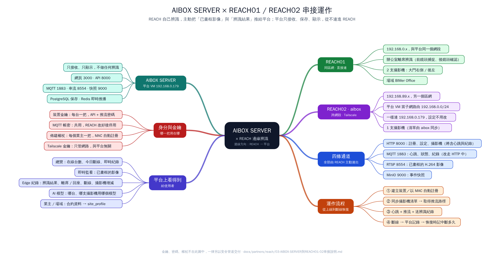

# AIBOX SERVER 平台 × REACH01 / REACH02 串接說明

> 給誰看：要了解、維護或排查這套串接的人（平台管理員、REACH 開發者、現場 IT）
> 內容：兩台 REACH 邊緣設備怎麼連到 AIBOX SERVER 平台、各傳什麼、平台上看得到什麼、出問題時看哪裡
> 本文件**不含**任何金鑰、密碼或權杖；這些只用安全管道另外交付。



（向量版：[`images/aibox-reach-mindmap.svg`](images/aibox-reach-mindmap.svg)）

---

## 1. 一句話說明

**REACH 設備自己辨識、自己判斷，再主動把「已畫框的影像」和「辨識結果」推到 AIBOX SERVER；
AIBOX SERVER 只負責接收、保存、顯示，不做任何辨識，也從不主動連進 REACH。**

```text
          REACH01（同區網）                               AIBOX SERVER 平台（VM 192.168.0.179）
  攝影機 ─► 拉流 ─► YOLO / 離席判斷 ─► 畫框 ──┐
                                               │  HTTP 8000   登記攝影機、取設定、快照上傳簽章
          REACH02 / aibox（192.168.89.x）      ├─►MQTT 1883   心跳、狀態、辨識紀錄
  攝影機 ─► 拉流 ─► 辨識 ─► 畫框 ──Tailscale──┤  RTSP 8554   已畫框的 H.264 即時影像
                                               │  MinIO 9000  快照圖片
                                               └──────────────► 網頁 3000：總覽 / 即時監看 / Edge 紀錄 …
```

---

## 2. 參與的角色

| 角色 | 位置 | 負責 |
|------|------|------|
| **AIBOX SERVER 平台** | Ubuntu VM `192.168.0.179`（辦公室區網 `192.168.0.0/24`），Docker Compose | 接收、保存、顯示；帳號權限；多場域總覽 |
| **REACH01**（REACH Office Vision） | 辦公室區網，和平台**同網段** | 兩支攝影機的辦公室離席辨識（前鏡頭捕捉、後鏡頭確認） |
| **REACH02**（aibox） | 另一個區網 `192.168.89.0/24` | 一支攝影機的辨識 |
| **Tailscale（B 帳號）** | 平台 VM 與 aibox 都已加入 | 讓不同網段的 aibox 連得到平台 |

### 平台上的服務

| 服務 | Port | 用途 | 誰會連 |
|------|------|------|--------|
| 網頁（frontend） | 3000 | 管理與監看介面 | 使用者瀏覽器 |
| API（backend） | 8000 | REST API（含 Edge 用的 `/api/v1/edge/*`） | 瀏覽器、REACH |
| MQTT（Mosquitto） | 1883 | 心跳、狀態、辨識紀錄 | REACH |
| 串流（MediaMTX） | 8554 / 8889 / 8888 | 收 REACH 推來的影像；轉給瀏覽器（WebRTC / HLS） | REACH 推；瀏覽器看 |
| 物件儲存（MinIO） | 9000 | 快照圖片 | REACH 上傳；瀏覽器下載 |
| PostgreSQL / Redis | 內部 | 資料庫 / 即時推播 | 只有平台自己 |

---

## 3. 兩台設備的連線方式

### REACH01：同一個區網，直接連

```text
REACH01 (192.168.0.x) ──區網──► 192.168.0.179 : 8000 / 1883 / 8554 / 9000
```

- 不需要 VPN，也不需要在 REACH01 開任何對外 port。
- 平台場域：**BIMer Office**（`bimer-office`）。
- 攝影機（由 REACH01 自己管理，平台不保存攝影機位址與帳密）：

  | 攝影機代碼 | 名稱 | 推流路徑 |
  |---|---|---|
  | `bimer-entrance-right` | BIMer 大門右側（前鏡頭，主捕捉） | `ai/bimer-office/REACH01/bimer-entrance-right` |
  | `bimer-back-left` | BIMer 後左（後鏡頭，確認） | `ai/bimer-office/REACH01/bimer-back-left` |

### REACH02（aibox）：不同區網，經 Tailscale

```text
aibox (192.168.89.x) ──Tailscale──► 平台 VM（子網路由 192.168.0.0/24）──► 192.168.0.179 : 8000 / 1883 / 8554 / 9000
```

- 平台 VM 在 Tailscale 宣告 `192.168.0.0/24`（子網路由），並已在 B 帳號後台核准。
- aibox 接受路由（Linux 用 `--accept-routes`），所以**一樣直接連 `192.168.0.179`**，設定和 REACH01 完全相同。
- 好處：平台設定、快照上傳網址、推流網址都不用為 aibox 另外改；換 Tailscale 帳號或 Tailscale IP 改變也不影響。
- 限制：兩邊區網不能重疊（目前 `192.168.0.x` 與 `192.168.89.x` 不重疊）。
- 攝影機：目前 **1 支**（由 aibox 自己管理；之前登記過但已移除的攝影機會被同步標示為「已不在 Edge 上」）。

> **連線方向永遠是 REACH → 平台。** 平台不需要知道 REACH 的 IP；REACH 換網段時只要還連得到 `192.168.0.179`，
> 平台不用改任何設定，約 10 秒內自動恢復在線。

---

## 4. 四條通道：各傳什麼

| 通道 | 方向 | 內容 | 頻率 |
|------|------|------|------|
| **HTTP API**（8000） | REACH → 平台 | 註冊 / 取設定（`/edge/register`、`/edge/config`）；**同步攝影機清單**（`PUT /edge/cameras`，回傳每支攝影機的推流路徑）；快照上傳簽章（`/edge/snapshots/presign`） | 啟動時、攝影機增減時、要上傳快照時 |
| **MQTT**（1883） | REACH → 平台 | `edge/{裝置}/heartbeat` 心跳（含 CPU / GPU、**正在用的模型**）<br>`edge/{裝置}/status` 上線 / 離線（含 Last Will）<br>`edge/{裝置}/cameras/{攝影機}/status` 攝影機健康與 FPS<br>`edge/{裝置}/cameras/{攝影機}/logs` 辨識紀錄（例：`office.leave` 離席） | 心跳 10 秒、攝影機狀態 5 秒、紀錄即時 |
| **RTSP 推流**（8554） | REACH → 平台 | 已畫框、已畫 ROI 的 H.264 即時影像，推到 `ai/<場域>/<裝置>/<攝影機>` | 持續 |
| **快照上傳**（9000） | REACH → MinIO | 事件發生當下的畫框 JPEG（用一次性簽章網址 PUT） | 事件成立時（選用） |

**影像不會走 MQTT，辨識結果也不會走影像串流**——兩者分開，任何一條斷了另一條不受影響。

> **轉換中：MQTT → HTTP。** 平台已提供同樣功能的 HTTP 端點：
> `POST /edge/heartbeat`、`/edge/status`、`/edge/cameras/{攝影機}/status`、`/edge/logs`。
> JSON 內容與 MQTT 相同，改用每台自己的裝置金鑰驗證，不再需要共用的 MQTT 帳密。
>
> - REACH 要改的地方見 [`05-REACH-更新規格v2.md`](05-REACH-更新規格v2.md)。
> - REACH01、REACH02 都改好之後，平台會停用 MQTT 共用帳號，四條通道就只剩 HTTP、RTSP、快照三種連線。
> - 進度可在「邊緣裝置」頁的**通訊方式**欄位查看。

### 辨識紀錄如何「更新同一筆」

REACH 的離席事件從「離開」到「回座」會送兩次，**用同一個 `event_id`**：

```text
09:15:10  office.leave  status=open      data={seat_id: S01, leave_time: 09:15:10, confirmed_at: 09:15:13}
09:20:31  office.leave  status=returned  data={return_time: 09:20:31, away_seconds: 321}
          → 平台上是「同一筆」紀錄，狀態變成 returned，data 合併保留 leave_time 與 return_time
```

---

## 5. 身分與金鑰（哪一把用在哪裡）

| 憑證 | 一台一把？ | 用在 | 誰保管 | 外洩時 |
|------|-----------|------|--------|--------|
| **裝置金鑰**（Device Key） | ✅ 每台不同 | HTTP 的 `X-Device-Key`；RTSP 推流密碼（帳號 = 裝置 ID） | REACH 的 env 檔 | 平台「邊緣裝置 → 更換金鑰」，舊的立即失效 |
| **MQTT 帳密** | ❌ 所有 Edge 共用 | 連 MQTT | REACH 的 env 檔 | 改 `.env` 的 `MQTT_EDGE_PASSWORD` 並通知所有 Edge |
| **佈建權杖**（Provisioning Token） | 每個**業主**一把 | 新設備以 MAC 自動註冊（`/edge/register`） | 設備出廠設定 | 平台「業主 → 佈建權杖 → 撤銷」；已註冊的設備不受影響 |
| **Tailscale Auth Key** | — | 只用來讓機器加入 Tailscale 網路，**與平台無關** | 網管 | Tailscale 後台撤銷 |

> 常見錯誤：把 Tailscale 的 `tskey-auth-…` 當成裝置金鑰填進 `AIBOX_DEVICE_KEY`——兩者完全不同。

---

## 6. 上線流程

### 方式 A：手動建立（REACH01、REACH02 目前的方式）

1. 管理員在平台「邊緣裝置 → + 新增裝置」建立 `REACH01` / `REACH02`。
2. 平台跳出**連線資訊**（裝置金鑰只顯示這一次＋整份設定），用安全管道交給對方。
3. REACH 填入 env、重啟 → 同步攝影機清單 → 開始送心跳、推流、送紀錄。

### 方式 B：以 MAC 自動註冊（新出廠的 REACH AI BOX）

1. 管理員在「業主」頁產生**佈建權杖**，放進設備出廠設定。
2. 設備按「自動綁定（MAC）」→ `POST /edge/register`（帶 MAC）→ 平台指派 `REACH03`、`REACH04`… 並回傳金鑰與 `site_profile`（業主 / 場域 / 合約資料）。
3. 之後流程同方式 A 的第 3 步。

> **REACH01 / REACH02 若改用自動綁定**：先在平台編輯該裝置，**填入設備的 MAC 並選業主**（預先綁定），
> 自動綁定時就會沿用原本的 ID 與歷史資料，不會重複建立。

---

## 7. 平台上看得到什麼

| 頁面 | 內容 |
|------|------|
| **總覽** | 在線 / 離線台數、今日斷線次數、今日 Edge 紀錄數；即時 Edge 紀錄與即時偵測（顯示「場域 › 設備 › 攝影機」） |
| **即時監看** | 兩台設備所有攝影機的畫框影像，自動依螢幕排版、可全螢幕 |
| **Edge 紀錄** | 每一筆辨識結果（離席、回座…）＋平台自己的紀錄：`system.connection`（斷線 / 恢復）、`system.camera_sync`（攝影機增減）、`system.platform`（平台重啟） |
| **邊緣裝置** | 在線狀態、最後回報、24 小時斷線次數、MAC、業主、使用中的模型；連線資訊、更換金鑰、稽核紀錄 |
| **攝影機** | 每支攝影機的健康狀態、推流路徑、使用中的模型；「已不在 Edge 上」的攝影機可一鍵清除 |
| **AI 模型** | 哪個模型（含版本）在哪台設備、哪幾支攝影機使用；版本不一致會標黃 |
| **業主 / 場域** | 業主、合約、授權資料（會以 `site_profile` 傳回設備）；佈建權杖 |

### 平台怎麼判斷「斷線」

| 狀況 | 平台多快知道 | 紀錄 |
|------|-------------|------|
| REACH 正常關機 | 立即（REACH 送出 offline） | `system.connection`，原因「Edge / MQTT 回報」 |
| REACH 當機 / 斷電 | 數秒～45 秒（MQTT Last Will） | 同上 |
| 網路中斷 | 30 秒沒有心跳 | 原因「心跳逾時」，離線時間 = 最後一次心跳 |
| 恢復 | 下一次心跳 | 同一筆改成「已恢復，中斷 X 分 Y 秒」 |

---

## 8. 出問題時看哪裡

| 現象 | 先檢查 | 再檢查 |
|------|--------|--------|
| 裝置一直「待連線 / 離線」 | REACH 上 `curl http://192.168.0.179:8000/api/v1/health` | MQTT 帳密是否正確；VM 防火牆 1883 |
| REACH02 連不到平台 | aibox 上 `tailscale status`（看得到平台 VM？） | B 後台是否核准 `192.168.0.0/24`；aibox 是否接受路由；VM `sysctl net.ipv4.ip_forward = 1` |
| 有心跳但沒畫面 | 平台「攝影機」該支的串流狀態 | 推流路徑是否用平台回傳的 `stream_path`；8554 是否被擋；裝置金鑰是否正確 |
| 畫面有但 Edge 紀錄沒資料 | 平台 `docker compose logs backend \| grep -i dropped` | JSON 格式、`device_id` 是否與 topic 一致 |
| HTTP 401 | 裝置金鑰錯或已更換 | 是否誤填 Tailscale 金鑰；等號後是否多了空白 |
| HTTP 403 | 裝置被停用 / 除役 | 平台「邊緣裝置 → 編輯 → 管理狀態」 |
| 多出不存在的攝影機 | 「攝影機」頁的「已不在 Edge 上」篩選 | REACH 是否在啟動時同步**完整**攝影機清單 |

平台端即時觀察指令（在 VM 的 `/opt/ai-monitor`）：

```bash
docker compose logs -f mosquitto | grep -iE "new client|disconnect|timeout"          # 誰連上 / 斷線
docker compose logs -f backend   | grep -iE "REACH0[12]|dropped|rejected|denied"     # 平台拒收原因
docker compose logs -f mediamtx  | grep -i "REACH0[12]"                               # 推流狀態
```

---

## 9. 安全重點

- 攝影機位址與帳密**只留在 REACH**，平台不保存、不經手。
- 金鑰、MQTT 密碼、佈建權杖只放在設備的 env 檔，不放 Git、不貼群組、不寫進 log。
- 平台只存金鑰與權杖的 hash；裝置金鑰與權杖都只在產生時顯示一次。
- 目前測試環境走 Tailscale（WireGuard 加密）＋ HTTP；**正式對外前要改 HTTPS**。
- MQTT 目前所有 Edge 共用一組帳密，外流就能冒充任何一台。因此改走 HTTP（每台自己的裝置金鑰），
  REACH 改好後停用共用帳號（[`05`](05-REACH-更新規格v2.md)、[`mqtt-to-http.md`](../../mqtt-to-http.md)）。

---

## 10. 相關文件

| 文件 | 內容 |
|------|------|
| [`01-AIBOX-SERVER-平台說明與串接訴求.md`](01-AIBOX-SERVER-平台說明與串接訴求.md) | 平台定位與分工 |
| [`02-REACH-需新增功能規格.md`](02-REACH-需新增功能規格.md) | REACH 端串接模組的開發與驗收規格 |
| [`05-REACH-更新規格v2.md`](05-REACH-更新規格v2.md) | **最新**：改走 HTTP、平台更名、統一紀錄規範（REACH 要改的地方） |
| [`../../mqtt-to-http.md`](../../mqtt-to-http.md) | 平台端停用 MQTT 共用帳號的步驟 |
| [`../../edge-integration.md`](../../edge-integration.md) | 通用 Edge 串接規格（欄位、topic、範例 JSON） |
| [`../../reach-edge-register/CLAUDE.md`](../../reach-edge-register/CLAUDE.md) / [`DELIVERY.md`](../../reach-edge-register/DELIVERY.md) | MAC 自動註冊契約與交付清單 |
